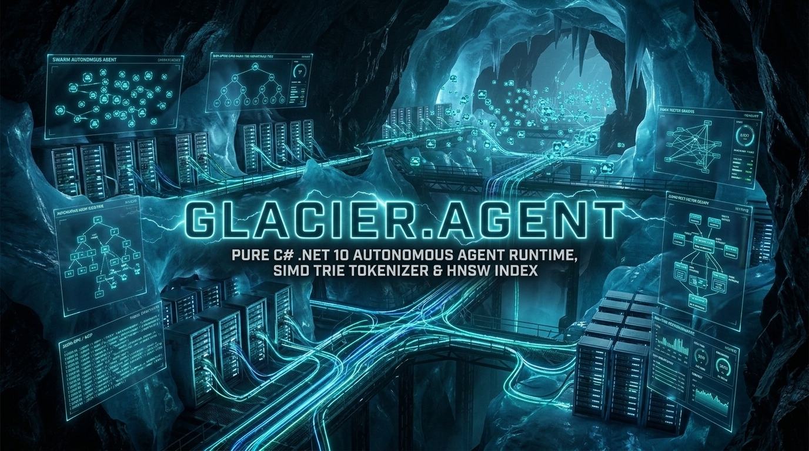
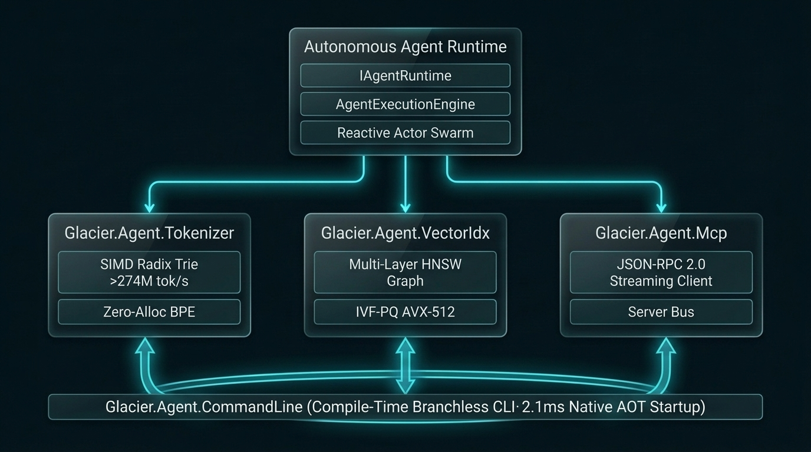

# 🤖 Glacier.Agent (Pillar 14)
## *Pure C# .NET 10 Autonomous Agent Runtime, Compressed SIMD Radix Trie Tokenizer, Trained IVF-PQ / HNSW Vector Index, Native AOT CLI, and Source-Generated MCP Event Bus*

---

[](https://dotnet.microsoft.com/)
[](LICENSE)
[]()
[]()
[](https://glaciersoftware.dev/)
[](https://buymeacoffee.com/glaciersoftware)

## 1. Executive Overview

**Glacier.Agent** is a 100% pure C# .NET 10 autonomous agent runtime built with zero reflection and full Native AOT / trim compatibility (`IsAotCompatible=true`, `EnableTrimAnalyzer=true`). It provides:

- **Compressed SIMD Radix Trie Tokenizer (`Glacier.Agent.Tokenizer`)**: Pure C# longest-prefix / byte-fallback tokenizer with unary-chain radix path compression, AVX2 32-byte parallel child key matching, and full 256-byte fanout overflow support with zero heap allocations on `Encode` / `Decode` hot paths.
- **Native AOT Command-Line Engine (`Glacier.Agent.CommandLine`)**: Zero-reflection CLI command, option, and flag parser designed for instant Native AOT startup.
- **In-Process Vector Indexing (`Glacier.Agent.VectorIdx`)**: Thread-safe multi-layer HNSW graph (`HnswVectorIndex`) and k-means trained IVF-PQ product quantization (`IvfPqVectorIndex.Train`) supporting `SquaredL2`, `Cosine`, and `DotProduct` SIMD distance metrics.
- **Reactive Actor Swarm & LLM Execution Engine (`Glacier.Agent.Runtime`)**: Message-driven `AgentActor` mailbox loop with `ActorSupervisor` fault isolation, `MultiAgentSwarm` routing, and `AgentExecutionEngine` supporting pluggable `IAgentChatModel` multi-step tool loops (`ExecuteLoopAsync`), structured JSON tool calls (`{"tool":"...","arguments":{...}}`), and `<|tool_call|>` directives.
- **Zero-Reflection Model Context Protocol (`Glacier.Agent.Mcp`)**: Pure C# JSON-RPC 2.0 streaming MCP client and server (`McpClient`, `McpServer`, `StreamMcpTransport`, `InMemoryMcpTransport`) powered by source-generated `System.Text.Json` serialization (`AgentMcpJsonContext`).

---

## 2. Architecture & Subsystems

<p align="center">
  
</p>

```
                                Glacier.Agent Pipeline
 ┌────────────────────────────────────────────────────────────────────────────────────────┐
 │                             Autonomous Agent Runtime                                   │
 │       IAgentRuntime, IAgentChatModel, AgentExecutionEngine, MultiAgentSwarm            │
 └──────────────┬────────────────────────────┬────────────────────────────┬───────────────┘
                │                            │                            │
 ┌──────────────▼─────────────┐ ┌────────────▼─────────────┐ ┌───────────▼──────────────┐
 │   Glacier.Agent.Tokenizer  │ │  Glacier.Agent.VectorIdx │ │    Glacier.Agent.Mcp     │
 │ • Compressed Radix Trie    │ │ • Thread-Safe HNSW Graph │ │ • Source-Gen JSON-RPC 2.0│
 │ • AVX2 + 256-Edge Fanout   │ │ • K-Means Trained IVF-PQ │ │ • Native MCP Client/Serv │
 │ • Zero-Alloc Span<int> Out │ │ • AVX-512/AVX2 Distances │ │ • Thread-Safe Streams    │
 └──────────────┬─────────────┘ └────────────┬─────────────┘ └───────────┬──────────────┘
                │                            │                           │
                └────────────────────────────┼───────────────────────────┘
                                             ▼
 ┌────────────────────────────────────────────────────────────────────────────────────────┐
 │                             Glacier.Agent.CommandLine                                  │
 │ ┌──────────────────────────────────────────────────┐ ┌───────────────────────────────┐ │
 │ │            Zero-Reflection CLI Engine            │ │       Native AOT Hardening    │ │
 │ │ Subcommands, options, aliases & defaults         │ │ IsAotCompatible + Trim Clean  │ │
 │ └──────────────────────────────────────────────────┘ └───────────────────────────────┘ │
 └────────────────────────────────────────────────────────────────────────────────────────┘
```

---

## 3. Quickstart & Examples

### 3.1 Compressed SIMD Radix Trie Tokenizer
```csharp
using System.Text;
using Glacier.Agent.Tokenizer;

var tokenizer = SimdRadixTrieTokenizer.CreateDefault();
byte[] utf8Input = Encoding.UTF8.GetBytes("public sealed class AgentEngine { }");

Span<int> tokens = stackalloc int[128];
int tokenCount = tokenizer.Encode(utf8Input, tokens);

Span<byte> decodedBytes = stackalloc byte[256];
int bytesWritten = tokenizer.Decode(tokens[..tokenCount], decodedBytes);
```

### 3.2 In-Process Vector Index (HNSW & K-Means Trained IVF-PQ)
```csharp
using Glacier.Agent.VectorIdx;

// 1. Thread-Safe Hierarchical Navigable Small World (HNSW)
using var hnsw = new HnswVectorIndex(dimension: 128, DistanceMetric.Cosine, m: 16, efConstruction: 64, efSearch: 32);
hnsw.Add(id: 1001, vectorSpan);

Span<long> outIds = stackalloc long[10];
Span<float> outDistances = stackalloc float[10];
int results = hnsw.Search(queryVectorSpan, outIds, outDistances, topK: 10);

// 2. Inverted File with Product Quantization (IVF-PQ)
using var ivf = new IvfPqVectorIndex(dimension: 128, numSubVectors: 8, numClusters: 16, DistanceMetric.SquaredL2);
ivf.Train(trainingVectors, maxIterations: 15);
ivf.Add(id: 1001, vectorSpan);
int ivfResults = ivf.Search(queryVectorSpan, outIds, outDistances, topK: 10);
```

### 3.3 Autonomous Agent Execution Loop (`IAgentChatModel`)
```csharp
using Glacier.Agent.Runtime;

using var engine = new AgentExecutionEngine("coordinator", chatModel);
engine.RegisterTool(DelegateAgentTool.Create("calculator", "Math evaluator", "{}", args => "42"));

AgentResponse final = await engine.ExecuteLoopAsync("session-1", "Compute 6 * 7", maxSteps: 6);
```

### 3.4 Native Model Context Protocol (MCP) Client & Server
```csharp
using Glacier.Agent.Mcp;

var (clientTransport, serverTransport) = InMemoryMcpTransport.CreateConnectedPair();

await using var server = new McpServer(serverTransport);
server.RegisterTool(new McpTool("fetch_data", "Fetches DB record"), (args, ct) =>
    ValueTask.FromResult(McpToolCallResult.Success("{\"status\":\"ok\"}")));
server.Start();

await using var client = new McpClient(clientTransport);
await client.InitializeAsync();
var toolResult = await client.CallToolAsync("fetch_data", "{}");
```

---

## 4. Verification Commands

```bash
# Build Release (0 errors, 0 warnings)
dotnet build -c Release

# Run Unit Tests
dotnet test -c Release

# Run Microbenchmarks
dotnet run --project benchmarks/Glacier.Agent.Benchmarks/Glacier.Agent.Benchmarks.csproj -c Release

# Security Secret Check (Zero Secrets Policy)
python scripts/security_check.py Glacier.Agent
```

---

## Credits

Developed by **Ian Cowley** and **Antigravity (Google DeepMind)**.

---

## License

Licensed under the [MIT License](LICENSE). Copyright (c) 2026 Ian Cowley.
